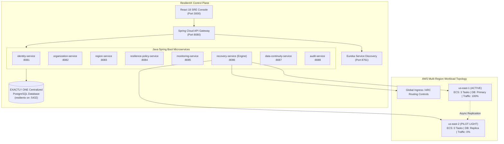

# ResilientX — Architectural Blueprint & Design Document

## 1. Executive Summary
**ResilientX** is an enterprise-oriented Disaster Recovery (DR) and Resilience Management Platform. It provides a centralized control plane for workload registration, continuous multi-region health observability, automated failure detection, ordered DR state-machine failover orchestration, human approval stage gates, dynamic traffic redirection, cryptographic data integrity verification, and controlled failback.

---

## 2. Architectural Pillars

### 2.1 The Pilot Light Model (Active / Standby)
Unlike *Warm Standby* (where standby compute runs at reduced capacity 24/7) or *Active/Active* (where both regions actively process traffic), ResilientX implements the **AWS Pilot Light Disaster Recovery Architecture**:
* **Primary Region (`us-east-1`):** Active Compute (ECS Fargate running tasks = 3, 100% traffic allocation) + Read/Write Primary Database.
* **Recovery Region (`us-east-2`):** Standby Compute (ECS Fargate running tasks = 0, 0% traffic allocation) + Continuous Asynchronously Replicated Standby Database.

### 2.2 Control Plane vs Data Plane Separation
* **ResilientX Control Plane:** Operates independently of the protected business workloads to guarantee observability during regional infrastructure failure.
* **Protected Data Plane:** Workload transactions (`Customer`, `Transaction`) replicated across regions with sub-second lag monitoring.

---

## 3. Microservice Responsibilities & Logical Ownership

All microservices connect to **ONE central PostgreSQL database (`resilientx`)**, preserving logical boundary ownership through domain APIs and OpenFeign:

1. **`eureka-server` (Port 8761):** Dynamic service discovery and liveness heartbeat monitoring.
2. **`api-gateway` (Port 8080):** Centralized ingress proxy, JWT validation, correlation ID (`X-Correlation-ID`) generation, CORS policies, and Eureka load-balanced routing (`lb://*`).
3. **`identity-service` (Port 8081):** RBAC authorization, BCrypt password hashing, JWT token issuance for `PLATFORM_ADMIN`, `DR_OPERATOR`, `DR_APPROVER`, `DR_AUDITOR`, and `VIEWER`.
4. **`organization-service` (Port 8082):** Multi-tenant organization, environment, and application registry management.
5. **`region-service` (Port 8083):** Regional topology, compute capacity, active/pilot-light roles, and ingress traffic percentages.
6. **`resilience-policy-service` (Port 8084):** Declarative DR policies, target RTO/RPO SLAs, and human approval rules.
7. **`monitoring-service` (Port 8085):** Health check probing, degraded state impact assessments, and telemetry aggregation.
8. **`recovery-service` (Port 8086):** Core Disaster Recovery Engine, state machine execution, human approval gates, execution strategy pattern (`SimulationExecutionStrategy` & `AwsExecutionStrategy`), and failback.
9. **`data-continuity-service` (Port 8087):** Real-time replication lag tracking, SHA-256 cryptographic ledger checksum verification.
10. **`audit-service` (Port 8088):** Tamper-evident immutable audit logs tracing every operator action and recovery decision.
