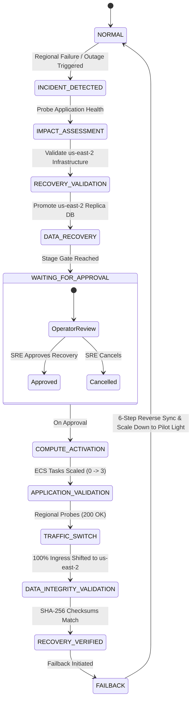

# ResilientX — Recovery Engine & Disaster State Machine

## 1. Ordered Recovery Workflow
ResilientX implements a deterministic state machine modeled after AWS Application Recovery Controller (ARC) Region Switch principles:

---

## 2. Dynamic RTO & RPO Calculation

### Recovery Time Objective (RTO)
Calculated from high-precision backend timestamps:
$$\text{RTO} = t_{\text{recoveryCompletedAt}} - t_{\text{failureDetectedAt}}$$

**Granular Duration Sub-Breakdown:**
* $\Delta t_{\text{detection}} = t_{\text{impactAssessed}} - t_{\text{failureDetected}}$
* $\Delta t_{\text{db\_recovery}} = t_{\text{dbPromoted}} - t_{\text{dbStart}}$
* $\Delta t_{\text{approval}} = t_{\text{approved}} - t_{\text{gateReached}}$
* $\Delta t_{\text{compute}} = t_{\text{ecs3TasksReady}} - t_{\text{ecsScaleStart}}$
* $\Delta t_{\text{validation}} = t_{\text{health200OK}} - t_{\text{healthProbeStart}}$
* $\Delta t_{\text{traffic}} = t_{\text{ingress100Percent}} - t_{\text{arcSwitchStart}}$

### Recovery Point Objective (RPO)
Determined dynamically by comparing the timestamp of the latest transaction recorded on Primary before regional failure against the timestamp of the latest transaction successfully committed on the Recovery Replica:
$$\text{RPO} = t_{\text{primary\_failure}} - t_{\text{last\_replicated\_txn}}$$

---

## 3. Human Approval Gate
In alignment with the reference architecture, critical recovery actions require explicit operator sign-off before allocating compute resources and rerouting global customer traffic.
* Authorized Role: `DR_APPROVER` / `PLATFORM_ADMIN`
* Recorded Metadata: `approvedBy`, `approvedAt`, `approvalReason`, `correlationId`
